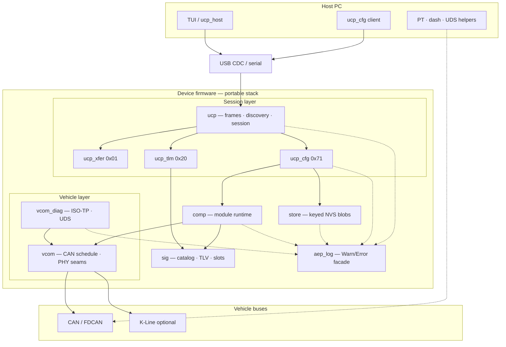

# Auto Embedded Platform

Portable MIT libraries for talking to a vehicle ECU from a host PC: framed USB/serial sessions, live signal telemetry, configurable on-device modules, CAN scheduling, and UDS over ISO-TP.

Use this when you need a **board that bridges USB ↔ vehicle buses**, streams typed signals to a host tool, and lets the host enable or reconfigure firmware modules without flashing a new image.



Board bring-up (HAL, ThreadX, USBX) stays outside the portable trees. The STM32H523 example shows how to wire the seams; product firmware copies the libraries and implements the same port hooks.

**Docs:** [Quickstart](docs/QUICKSTART.md) · [Architecture](docs/ARCHITECTURE.md) · [Doc index](docs/index.md) · [Example bring-up](examples/stm32_h5/BRINGUP.md)

---

## What you can do with it

| Capability | What it means in practice |
| --- | --- |
| **Host ↔ device session** | Reliable framed packets over USB CDC (or any byte pipe). Discovery negotiates roles and advertised apps. |
| **Live telemetry** | Typed signals (`sig`) streamed as TLV over UCP app `0x20`. Host can pull a directory and publish revisions. |
| **Remote config** | UCP app `0x71` lists component slots, applies packs in RAM, and save/loads them through `store`. |
| **Pluggable modules** | `comp` runs PT parsers, PID clients, cluster/dash writers, etc. Start/stop/poll without hard-coding the session layer. |
| **Vehicle TX/RX** | `vcom` schedules classic CAN frames behind PHY vtables (FDCAN, K-Line, …). No HAL inside the library. |
| **Diagnostics** | `vcom_diag` wraps ISO-TP + UDS (`iso14229`) for PID reads and similar client/server flows. |
| **Host tooling** | Python session client, config CLI, Textual TUI, PT/dash generators, mock UDS ECU — smoke the stack without a custom GUI. |

### Typical use case

A development or aftermarket board sits on the vehicle network and on a USB cable to a laptop:

1. Host opens a UCP session over CDC and discovers telemetry + config apps.
2. On-device components parse PT / PID / cluster traffic on one or more CAN buses into the signal table.
3. Host TUI or scripts subscribe to live signals and flip component slots (e.g. PT-A vs PT-B, dash enable) without rebuilding firmware.
4. Optional UDS client on the board talks to a real or mock ECU for PIDs.

The dual-bus PT demo in the example is that story end-to-end: [DEMO_PT.md](examples/stm32_h5/DEMO_PT.md).

---

## How the pieces connect

| Layer | Libraries | Job |
| --- | --- | --- |
| **Session** | `ucp`, `ucp_xfer` | Byte framing, parser, discovery/session, chunked transfers |
| **Apps on UCP** | `ucp_tlm`, `ucp_cfg` | Telemetry (`0x20`) and component config (`0x71`), both V1.0 (`0x0100`) |
| **Signals** | `sig` | Catalog ids, TLV codec, slot table — no RTOS/HAL |
| **Modules** | `comp`, `store` | Descriptor registry, apply/poll; keyed blobs for save/load |
| **Vehicle** | `vcom`, `vcom_diag` | CAN schedule + PHY seams; ISO-TP/UDS on top |
| **Logging** | `aep_log` | Compile-gated Warn/Error (sparse Info); glue owns `aep_port_log` |
| **Glue** | `examples/stm32_h5/` | USB CDC ↔ `ucp`, FDCAN/K-Line PHYs, demo components |
| **Host** | `tools/` | Session, TUI, generators, UDS helpers |

Portable code has no Cube HAL and no Azure RTOS. Example glue implements `ucp_port_*`, `aep_port_log`, PHY vtables, and `store_port_*`. Product trees do the same.

---

## Repository map

| Path | Role |
| --- | --- |
| [`aep_log/`](aep_log/README.md) | Shared log facade — `AEP_LOGW`/`E`, default level WARN |
| [`sig/`](sig/README.md) | Tier A catalog, TLV codec, slot table |
| [`ucp/`](ucp/README.md) | Frame, parser, session, port hooks |
| [`ucp_tlm/`](ucp_tlm/README.md) | Telemetry app `0x20` / V1.0 |
| [`ucp_cfg/`](ucp_cfg/README.md) | Config app `0x71` / V1.0 — slots, apply, save |
| [`comp/`](comp/README.md) | Component descriptors, slots, apply/poll |
| [`store/`](store/README.md) | Keyed NVS blobs via `store_port_*` |
| [`vcom/`](vcom/README.md) | CAN frame, PHY vtable, TX scheduler |
| [`vcom_diag/`](vcom_diag/README.md) | `diag_link` / `diag_server` + `iso14229` 0.11.0 |
| [`tools/`](tools/requirements.txt) | Host session, TUI, PT/dash generators, UDS helpers |
| [`examples/stm32_h5/`](examples/stm32_h5/README.md) | STM32H523 illustration — [BRINGUP](examples/stm32_h5/BRINGUP.md) · [GLUE](examples/stm32_h5/GLUE.md) |

---

## Getting started

**Host unit tests** (no board; needs MinGW `gcc` on `PATH`):

```powershell
./tools/run_host_tests.ps1
```

**Against a board** (after CubeMX generate + paste — see [BRINGUP.md](examples/stm32_h5/BRINGUP.md)):

```powershell
pip install -r tools/requirements.txt
python tools/ucp_host.py --port COMx
python tools/demo_tui.py --port COMx
```

Full path: [docs/QUICKSTART.md](docs/QUICKSTART.md).

---

## Defaults (example + tools)

| Item | Value |
| --- | --- |
| Telemetry app | `0x20` / `0x0100` (V1.0) |
| Config app | `0x71` / `0x0100` (V1.0) |
| Catalog revision | `SIG_CATALOG_REVISION` `0x0001` (counter, not major.minor) |
| UDS demo ids | request `0x7E0`, response `0x7E8` |

Version encoding: [UCP_APPLICATION_LAYER.md](ucp/docs/UCP_APPLICATION_LAYER.md).

---

## License

Portable libraries, host tools, and example glue are **MIT** — [LICENSE](LICENSE), [NOTICE](NOTICE).

ST HAL, CMSIS, and Azure RTOS (ThreadX / USBX) come from a CubeMX generate and keep their own licenses. They are not shipped in this repository. Details: [docs/LICENSING.md](docs/LICENSING.md).
