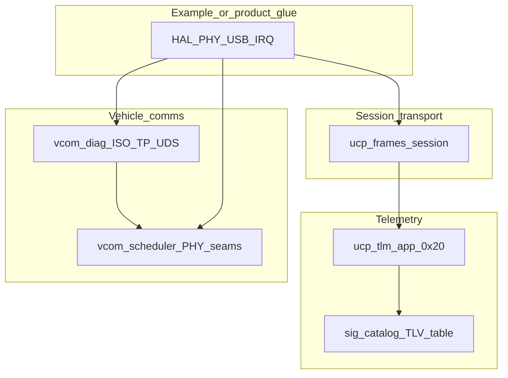

# Architecture

Public MIT portable stack. Board bring-up and HAL live only in examples (or your product glue). This page is an overview; each library has its own docs.

## Why each layer exists

| Directory | Why it exists |
| --- | --- |
| [`sig/`](../sig/README.md) | Typed signal ids, TLV codec, slot table — no RTOS/HAL |
| [`ucp/`](../ucp/README.md) | Framed packets, parser, discovery/session — portable across links |
| [`ucp_tlm/`](../ucp_tlm/README.md) | UCP app `0x20`: live TLV + directory (incl. catalog revision / publish) |
| [`ucp_cfg/`](../ucp_cfg/README.md) | UCP app `0x71`: component slots apply/save + pack ads |
| [`comp/`](../comp/README.md) | Portable component runtime (descs/slots/apply/poll/`on_can_rx`) |
| [`store/`](../store/README.md) | Keyed NVS blobs; media via `store_port_*` |
| [`vcom/`](../vcom/README.md) | Classic CAN scheduling + PHY vtables + `vcom_rx_demux` |
| [`vcom_diag/`](../vcom_diag/README.md) | ISO-TP + UDS via pinned `iso14229`, on top of `vcom` |
| [`examples/stm32_h5/`](../examples/stm32_h5/GLUE.md) | Proof that the seams work on STM32H523 + ThreadX + USBX |
| [`tools/`](../tools) | `ucp_host.py`, `ucp_cfg.py`, `pt_gen_a/b.py`, `dash_gen.py`, packs, UDS helpers |

## Demo defaults (example + host tools)

- Telemetry app: id `0x20`, version `0x0100` (V1.0, exact match)
- Config app: id `0x71`, version `0x0100` (V1.0)
- Protocol / xfer: `0x0100` (V1.0). Versioning: [UCP_APPLICATION_LAYER.md](../ucp/docs/UCP_APPLICATION_LAYER.md)
- Catalog revision: `SIG_CATALOG_REVISION` `0x0001` (counter, not major.minor)
- Roles: producer `TX|REQ_RSP`, consumer `RX|REQ_RSP`; if both advertise `REQ_RSP`, keep it and complementary TX/RX
- ISO-TP poll: **1 ms** from example glue; `iso14229` tag **0.11.0** under `vcom_diag/third_party/iso14229`
- UDS physical ids (host PID ECU ↔ board client): request `0x7E0`, response `0x7E8`
- License: MIT ([LICENSE](../LICENSE)); Cube packs via generate — [LICENSING.md](LICENSING.md)

## Where to read next

| Goal | Doc |
| --- | --- |
| Clone → host tests → board | [QUICKSTART.md](QUICKSTART.md) |
| Example bring-up (Cube generate) | [examples/stm32_h5/BRINGUP.md](../examples/stm32_h5/BRINGUP.md) |
| Example project map | [examples/stm32_h5/README.md](../examples/stm32_h5/README.md) |
| Example glue files | [examples/stm32_h5/GLUE.md](../examples/stm32_h5/GLUE.md) |
| Cube paths / pins | [examples/stm32_h5/INTEGRATION.md](../examples/stm32_h5/INTEGRATION.md) |
| Dual-bus demo | [examples/stm32_h5/DEMO_PT.md](../examples/stm32_h5/DEMO_PT.md) |
| Component / config model | [FUTURE_COMPONENTS_CONFIG.md](FUTURE_COMPONENTS_CONFIG.md) |
| Licenses | [LICENSING.md](LICENSING.md) |
| Per-library detail | Each `*/README.md` and `*/docs/` |
