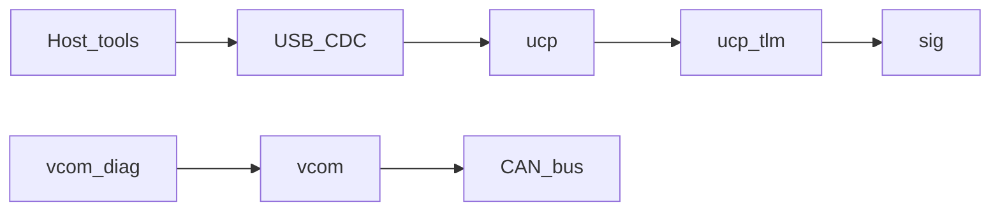

# Quickstart

Path from clone to host tests, then to a board that has been generated from CubeMX.

## What this repo is

A portable MIT stack for framed USB/serial sessions (UCP), signal telemetry, CAN/K-Line scheduling, and UDS over ISO-TP — plus one CubeIDE example that shows how to glue those libraries to STM32 HAL / ThreadX / USBX.

The example is an **illustration**. CubeMX must generate HAL, ThreadX, and USBX before that project builds. See [examples/stm32_h5/BRINGUP.md](../examples/stm32_h5/BRINGUP.md).



## 1. Host unit tests

Needs MinGW `gcc` on `PATH` (no board):

```powershell
./tools/run_host_tests.ps1
```

Or per library: `make -C sig/test test` (same for `ucp`, `vcom`, `vcom_diag`).

## 2. Open the example (after Cube generate)

1. Follow [examples/stm32_h5/BRINGUP.md](../examples/stm32_h5/BRINGUP.md): open the `.ioc`, generate, paste USER CODE, restore include paths and `portable/*` links.
2. Build **Debug**, flash the STM32H523 board.
3. Expect ~1 Hz LED blink and a CDC ACM COM port.

Glue map: [GLUE.md](../examples/stm32_h5/GLUE.md). Stack overview: [ARCHITECTURE.md](ARCHITECTURE.md).

## 3. Host smoke against the board

```powershell
pip install -r tools/requirements.txt
python tools/ucp_host.py --port COMx
```

### Dual-channel mock PT demo (recommended)

Uses a **2CH Kvaser**: channel 0 ↔ board CAN0 (PT + host UDS ECU), channel 1 ↔ board CAN1 (cluster).  
Install [Kvaser CANlib drivers](https://www.kvaser.com/download/) (not pip). Vector XL is not used.

```powershell
.\tools\run_pt_demo.ps1
python tools/ucp_cfg.py --port COMx list   # slots / PT-A|B / dash enable
```

Or the Textual TUI (owns the COM port):

```powershell
python tools/demo_tui.py --port COMx
```

Details: [DEMO_PT.md](../examples/stm32_h5/DEMO_PT.md). Component model: [FUTURE_COMPONENTS_CONFIG.md](FUTURE_COMPONENTS_CONFIG.md).

## Include paths for other firmware

Point your build at the repo-root `*/include` trees (and `vcom_diag/third_party/iso14229` with `-DUDS_SYS=0 -DUDS_TP_ISOTP_C`). Details: [BRINGUP.md](../examples/stm32_h5/BRINGUP.md).
