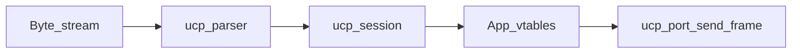

# ucp overview

Portable UCP is a **transport/session** core: framed packets on a byte stream, discovery/handshake, and READY keepalives. Applications (telemetry, services) register through `ucp_port` and receive routed packets when the session is READY.

Protocol details: [README.md](README.md) (index of frame format, handshake, state machine, services).

Stack context: [docs/ARCHITECTURE.md](../../docs/ARCHITECTURE.md).
